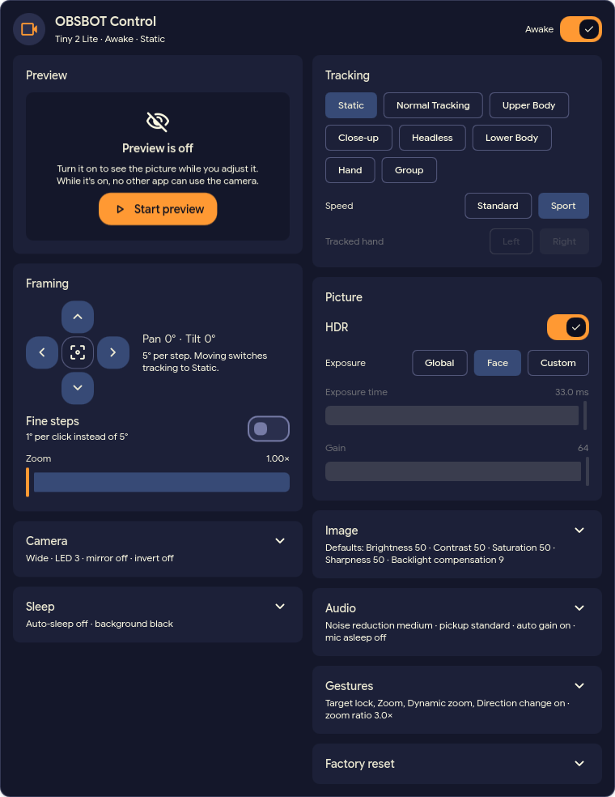

# dms-obsbot-control

DankMaterialShell bar widget for OBSBOT webcams.



## Supported cameras

The widget supports every camera that
[obsbot4linux supports](https://github.com/nofuturekid/obsbot4linux#supported-cameras),
currently the **OBSBOT Tiny 2 Lite**. It takes the camera's name and video device
from obsbot4linux, and shows only the cards the camera can do (its
`capabilities`).

The popout is 760 px wide with two columns of cards, each as high as its content.
Left: Preview, Framing, Camera, Sleep. Right: Tracking, Picture, Image, Audio,
Gestures, Factory reset. Collapsible cards start closed, one open per column, and
a closed card lists its settings under the title.

- header: OBSBOT Control, the camera model and its state, a spinner while a
  command is in flight, Awake switch
- preview frame (16:9, Qt Multimedia at 720p): live picture while the preview
  runs (no other app can use the camera meanwhile; it stops when the popout
  closes), otherwise a hint with one action: Start preview, Wake camera, or
  Retry when the camera or obsbot4linux can't be reached
- tracking: AI mode, speed, tracked hand
- framing: pan/tilt d-pad with live pose and fine steps, center, zoom; a manual
  move switches tracking to Static
- picture: HDR, exposure Global / Face / Custom (exposure time and gain)
- camera: field of view, status LED, mirror, invert
- sleep: auto-sleep and the picture while asleep
- image adjustments: brightness, contrast, saturation, sharpness, backlight
  compensation, reset to defaults
- audio: noise reduction, pickup distance, automatic gain, microphone while asleep
- gestures: gesture switches and zoom ratio
- factory reset with a two-click confirmation
- bar icon: videocam (accent) awake, videocam_off asleep, usb_off dimmed while
  unplugged (or hidden, see settings), a red dot while any application streams from the camera

Bar icon interactions:

| Input | Action |
| --- | --- |
| Left click | Open the popout |
| Right click | Wake / sleep the camera |
| Middle click | Tracking on/off: Static, and back to the last other mode (Normal Tracking if none yet) |
| Mouse wheel | Zoom in / out by 0.1 per notch, 1.0 to 4.0, while the camera is awake |
| Hover | Tooltip with the state, e.g. "Tiny 2 Lite · Awake · Static" |

On air: a red dot on the bar icon shows whenever an application streams from the
camera (a browser, OBS, ffmpeg, the widget's own preview). The tooltip and the
popout header add "On air: Chrome" and the like, the Control Center tile "On air".
This relies on obsbot4linux's detection of
[streaming applications](https://github.com/nofuturekid/obsbot4linux#streaming-applications),
which looks at processes that map the camera's capture buffers.

Control Center tile: the icon wakes or sleeps the camera, the subtitle shows its
state. A 4 × 4 tile shows the tracking modes and speed; the tile's detail page
also has the tracked hand.

Settings page: a tracking mode applied whenever the camera wakes up, and switches
for "Mouse wheel zooms" and "Middle click toggles tracking" (both on by default).
Right click is always sleep/wake.

Camera access goes through [OBSBot4Linux](https://github.com/nofuturekid/obsbot4linux) (`obsbot4linux`):
the widget keeps one `obsbot4linux watch` running, gets every state change as an event
(also changes made from the CLI or by the camera itself) and sends commands on
its stdin. Desk and Whiteboard tracking are not available with obsbot4linux. The bar pill is hidden while no supported
camera is plugged in.

## Install

Needs `obsbot4linux` 0.3.0 or newer on PATH; the plugin checks this when it is
enabled and refuses to activate without it (the camera itself does not have to
be plugged in). Packages for Arch, Debian/Ubuntu, Fedora/openSUSE
and a plain tarball are on its
[releases page](https://github.com/nofuturekid/obsbot4linux/releases). The live preview
also needs `qt6-multimedia`; without it the preview frame says so and every
other control still works.

From the DMS plugin browser, or manually:

```sh
git clone https://github.com/nofuturekid/dms-obsbot-control.git \
    ~/.config/DankMaterialShell/plugins/obsbotControl
dms ipc call plugins enable obsbotControl
```

Then add the `obsbotControl` widget to a bar in DMS settings.
After changing QML, run `dms restart` (`plugins reload` keeps cached components).

## Update

```sh
dms plugins update obsbotControl
dms restart
```

## Development

The code was written with Claude Code (AI) and reviewed and tested on a
Tiny 2 Lite.

## License

GPL-3.0-or-later, see [LICENSE](LICENSE).
